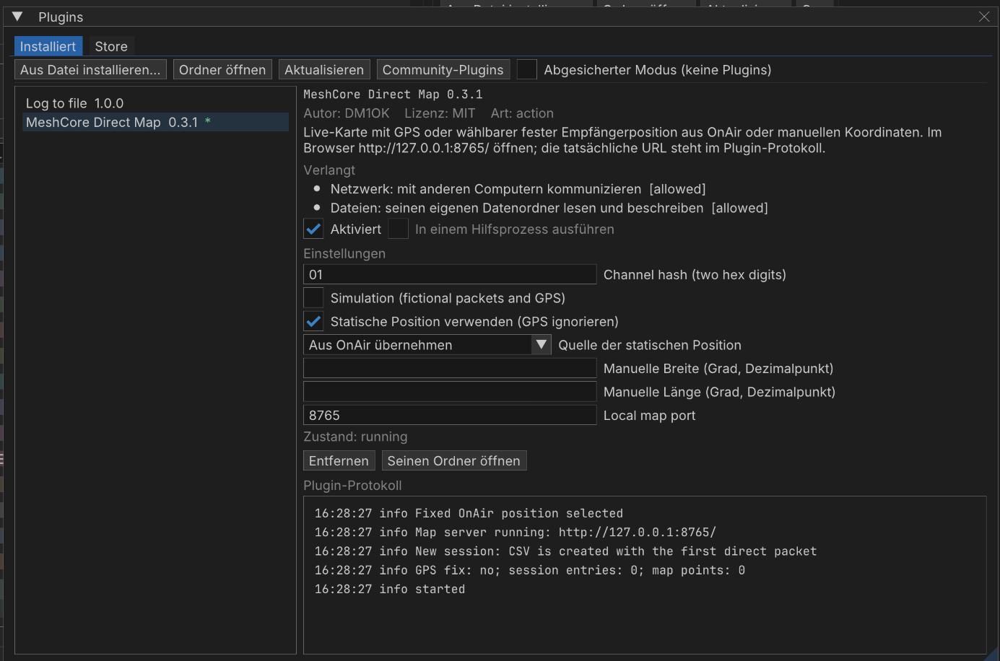
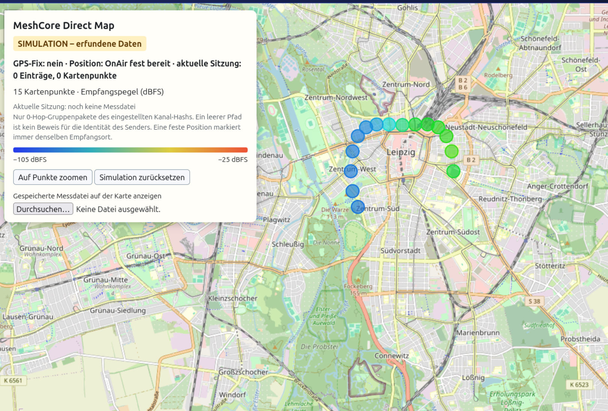

# MeshCore Direct Map 0.3.1

MeshCore Direct Map zeigt auf einer lokalen Browser-Karte, **wo** ein Empfänger MeshCore-Gruppenpakete ohne Hop-Einträge empfängt. Das OnAir-Plugin verbindet passende Pakete mit einer GPS- oder festen Empfängerposition und speichert echte Messungen als CSV. Ein leerer Hop-Pfad ist ein Hinweis auf direkten Empfang, kein sicherer Nachweis für den ursprünglichen Sender.

**Testversion für OnAir 4.4.0 · Linux x86-64 · Autor: DM1OK**

## Deutsch

### Demo

**Plugin-Einstellungen in OnAir:** Hier ist eine feste Empfängerposition aus OnAir gewählt; ein GPS-Fix liegt im Beispiel nicht vor.



**Browser-Karte im Simulationsmodus:** Alle gezeigten Punkte und Pegel sind erfunden. Kartenkacheln © OpenStreetMap-Mitwirkende.



### Herunterladen und installieren

Die [Plugin-Datei direkt herunterladen](https://github.com/g3orgs/meshcore-direct-map/releases/download/v0.3.1/meshcore-direct-map-0.3.1.onairplugin). Sie liegt auch unter [Releases → v0.3.1 → Assets](https://github.com/g3orgs/meshcore-direct-map/releases/tag/v0.3.1) als **eine** Datei namens `meshcore-direct-map-0.3.1.onairplugin`.

1. In OnAir **Einstellungen → Plug-ins und Skripte → Plug-ins öffnen…** wählen.
2. Unter **Installiert** auf **Aus Datei installieren…** klicken und die heruntergeladene Datei auswählen.
3. **MeshCore Direct Map** auswählen, Netzwerk- und Dateizugriff erlauben und **Aktiviert** anhaken.
4. Unter **Channel hash** genau zwei Hex-Ziffern für den gewünschten MeshCore-Kanal eintragen, etwa `01` oder `D9`.

Das Plugin erhält `lora.packet`-Ereignisse direkt von OnAir. **Log to file** wird nicht benötigt. Die Karte läuft im Browser; OnAir muss dafür nicht neu gebaut werden.

### Karte und Test ohne Funkempfang

Bei laufendem Plugin `http://127.0.0.1:8765/` im Browser öffnen. Die tatsächlich verwendete Adresse steht im Plugin-Protokoll hinter **Map server running**, falls der Port belegt ist oder über **Local map port** geändert wurde. Der Kartenserver ist nur auf dem eigenen Rechner erreichbar.

Für einen Test ohne Funk und GPS **Simulation (fictional packets and GPS)** einschalten. Die gelbe Kennzeichnung **SIMULATION** markiert erfundene Punkte; diese werden nie in eine Messdatei geschrieben. **Simulation zurücksetzen** leert die Karte und hält den Test an. **Simulation neu starten** beginnt erneut. Ausschalten der Simulation entfernt die Testpunkte.

### Echte Messungen

Für eine mobile Messung USB-GNSS und `gpsd` verwenden, **Simulation** und **Statische Position verwenden** ausschalten und in OnAir den MeshCore-Empfang starten. Ein GPS-Fix ist an einem `TPV`-Eintrag mit `mode` 2 oder 3 sowie `lat` und `lon` erkennbar (`gpspipe -w -n 15`). Ein fester USB-Gerätename ist im Plugin nicht nötig. Kartenpunkte entstehen nur bei passenden Gruppenpaketen mit leerem Hop-Pfad und gültiger Empfängerposition.

Ohne GPS kann man für einen stationären Empfänger **Statische Position verwenden (GPS ignorieren)** anhaken. Die Position kommt wahlweise aus OnAir **Einstellungen → Standort** oder aus manuell eingetragenen Koordinaten. Der Haken hat Vorrang vor GPS; Karte und CSV kennzeichnen die Quelle als `gps`, `onair` oder `manual`. Eine feste Position eignet sich nicht für eine Fahr-Heatmap.

Jeder **Plugin-Neustart** beginnt eine neue Sitzung. Beim ersten passenden echten Paket entsteht im Datenordner eine Datei `direct-packets-JJJJMMTT-HHMMSS.csv`. Stoppen und Starten nur des MeshCore-Empfangs erzeugt keine neue Sitzung. Die Karte zeigt GPS-Fix, Positionsquelle und Zähler. Mit **Gespeicherte Messdatei auf der Karte anzeigen** öffnet man eine ältere CSV lokal im Browser; **Zur Live-Karte** führt zur aktuellen Sitzung zurück. Im Paket liegt auch `BEISPIEL-FIKTIV.csv` mit ausdrücklich erfundenen Punkten.

### Grenzen

OnAir 4.4.0 übergibt an Action-Plugins SNR, aber keinen gemessenen Empfangspegel oder CRC-Status. Die Punktfarben zeigen deshalb vorläufig **SNR**, nicht Empfangsleistung. Ein leerer Hop-Pfad beweist weder die Identität noch den Standort des Senders; GPS im Freien und direkte Quellzuordnung sind noch nicht im Feld geprüft. Für vergleichbare Fahrmessungen sollten Antenne, Ausrichtung, Verstärkung und Funkparameter konstant bleiben. Der Browser lädt OpenStreetMap-Kacheln und Leaflet von öffentlichen Servern; diese erhalten die üblichen Anfragen und die IP-Adresse. Die Messdaten bleiben lokal.

Weitere Details stehen in der [deutschen Kurzanleitung](KURZANLEITUNG-DE.md).

## English

The [demo screenshots](#demo) above show the OnAir settings and a map with entirely fictional simulation points.

This OnAir 4.4.0 action plugin reads `lora.packet` events directly. It filters MeshCore `GRP_TXT` packets with a configurable channel hash (default `01`) and an empty flood path. An empty path is a **direct reception candidate**, not proof of a transmitter's identity. `log-to-file` is not needed.

This is an experimental Linux x86-64 release. Packet handling, CSV output, and the local map have automated tests; outdoor GPS reception and on-air source identification still need field validation.

### Install and run

Download [meshcore-direct-map-0.3.1.onairplugin](https://github.com/g3orgs/meshcore-direct-map/releases/download/v0.3.1/meshcore-direct-map-0.3.1.onairplugin) from the [v0.3.1 release assets](https://github.com/g3orgs/meshcore-direct-map/releases/tag/v0.3.1), or build it locally as shown below. In OnAir choose **Settings → Plug-ins and scripts → Open plug-ins → Install from file**, or copy the folder from `build/plugins/meshcore-direct-map` into the OnAir plugin folder. Enable it and allow filesystem and network access. The plugin uses the network only to read local `gpsd` and serve a map on loopback; map tiles and the Leaflet library are fetched by the browser from public servers.

Open **http://127.0.0.1:8765/** in a browser while the plugin is running, or double-click `map-open.html` in the plugin's `data` folder. `map_port` can choose another port from 1024 to 65535; the change takes effect when the plugin is restarted. If the chosen port is occupied, the plugin tries the next nine and writes the actual URL in its Plugin log as **Map server running**. The server listens only on `127.0.0.1`, serves measurements read-only, and allows a local simulation reset. It does not send your measurements to a remote service. The browser requests map tiles from OpenStreetMap and Leaflet from unpkg; those services see the tile requests and your IP address. An internet connection is needed for their assets.

The browser page refreshes its points every 1.5 seconds. Its yellow **SIMULATION** label means all displayed positions and levels are invented. The green **LIVE** label means it shows packets collected by this plugin. The page also shows GPS fix state, selected receiver position source, and current-session entry/map-point counts; the OnAir plugin log reports GPS transitions and entry counts. Simulation points are never added to a measurement CSV.

#### Simulation without radio or GPS

In the plugin manager, select **MeshCore Direct Map** and tick **Simulation (fictional packets and GPS)**. Open the local map URL. The test track starts empty and grows by one fictional point per second. Click **Simulation zurücksetzen** on the map to clear all test points and pause the demo. They stay gone until you click **Simulation neu starten** or toggle Simulation off and on again. Switching Simulation off removes the test points and returns to real measurements. A MeshCore receiver and GPS fix are not required for this test.

#### Real measurements

1. For mobile measurements, start `gpsd` with the USB GNSS receiver. A TPV `mode` of 2 or 3 with latitude and longitude is needed. The current basement test had no fix, so outdoor positioning remains unverified. Leave **Statische Position verwenden** unchecked.
2. Start MeshCore reception in OnAir. The `channel_hash` setting takes exactly two hexadecimal digits. The hash is a one-byte packet filter, not proof of channel ownership.
3. Each plugin start begins a new session. The first real direct candidate creates `direct-packets-YYYYMMDD-HHMMSS.csv` in the plugin's data folder; another activation uses a new file. Candidates without a receiver position remain in that CSV without coordinates. Stopping and starting MeshCore reception alone does not restart the action plugin or create a new session.

#### Fixed receiver position without GPS

Tick **Statische Position verwenden (GPS ignorieren)** in the plugin manager. This explicitly uses the selected fixed receiver position for every matching packet, even if a USB GPS later gets a fix. Select **Aus OnAir übernehmen** to use the station latitude and longitude entered in OnAir **Settings → Location**, or **Manuell eintragen** and enter decimal latitude/longitude in the two plugin fields. Untick the checkbox to return to GPS positioning. A fixed position is useful for a stationary receiver; moving the receiver without changing the fixed coordinates would put measurements in the wrong place.

OnAir 4.4.0 does not expose its global station position through the plugin ABI. On Linux, this plugin reads the two station coordinates from OnAir's `settings.conf` only when **Aus OnAir übernehmen** is selected. It follows `XDG_CONFIG_HOME` or `~/.config/onair/settings.conf`, refuses a cleared or invalid station location, and respects OnAir's streamer setting that hides the location. This Linux preference-file integration could need updating if OnAir changes its storage format. Manual coordinates do not depend on that file.

New CSV sessions use `receiver_lat`, `receiver_lon`, `position_age_s`, and `position_source` (`gps`, `onair`, or `manual`). A fixed position has no GPS age. The archive map still opens older files with `gps_lat` and `gps_lon` columns. Every map popup identifies whether the receiver position was live GPS or fixed.

The live map shows only the current session. Use **Gespeicherte Messdatei auf der Karte anzeigen** to select a previous session CSV, including the older `direct-packets.csv`; the browser parses it locally without uploading it to the map server. **Zur Live-Karte** returns to the current session. Historical files are never deleted automatically.

OnAir 4.4.0 passes packet bytes and SNR but not the receiver's measured level or CRC status to action plugins. The map therefore uses **SNR as a provisional quality measure** on unmodified OnAir and labels the CRC status as unknown. SNR is not received power. An upstream OnAir event extension would be needed for actual level and CRC fields. The map changes to dBFS if those fields are present.

The map is a **local browser page**, not a new pane inside OnAir. OnAir 4.4.0 has no Action-plugin map panel. No OnAir rebuild is needed for this plugin.

For comparable mobile measurements, keep receiver gain, antenna, orientation, and LoRa settings fixed. The map marks the receiver's position. Stronger readings narrow a search area but cannot by themselves locate the transmitter. A fixed position produces repeated points at one location and is not a mobile heatmap.

### Build and test

```bash
cmake -S . -B build
cmake --build build
ctest --test-dir build --output-on-failure
python3 tools/package_plugin.py
```

The package script writes `dist/meshcore-direct-map-0.3.1.onairplugin` from a fixed list of files. It does not include receiver logs or measurement CSVs. The loopback server test is skipped by sandboxes that prohibit socket binding; it has also been run outside that restriction. The current source and package target Linux. Windows and macOS need socket and GNSS adapters plus platform builds.

The older `tools/render_map.py` still produces a one-time HTML snapshot from the CSV. The embedded server is the live view.
